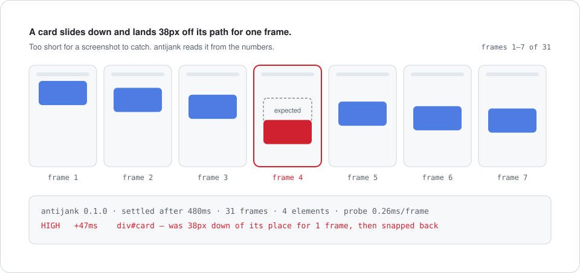

# antijank

[](https://github.com/imomadjid/antijank/actions/workflows/test.yml)
[](LICENSE)

Catch the one-frame UI glitches your coding agent can't see.

<picture>
  <source media="(prefers-color-scheme: dark)" srcset="assets/hero-dark.svg">
  
</picture>

Agents check UI with screenshots, and jank lives between them. A card that lands in the wrong place for one frame, a banner that shoves a list down 44px, a fade that never ran: each lasts about 16ms and is gone before the next screenshot.

antijank records every element's position and opacity on every frame of an interaction in a real browser, and reports what went wrong in a few lines of text:

```text
antijank 0.1.0 · settled after 343ms · 22 frames · 7 elements · probe 0.34ms/frame
HIGH   +10ms    div.row "a" ×4 — moved down 44px in one frame, with no transition [cause: div#banner inserted (1248×40)]
unanimated, fine if instant is intended (tabs, menus, frequent or keyboard-driven UI):
  MEDIUM +10ms    div#banner — appeared at full opacity with no fade (1248×40)
expect ✗ still others: 4 moved more than 1px: div.row "a" 44px; div.row "b" 44px; div.row "c" 44px
```

It's an [Agent Skill](https://skills.sh), the format Claude Code, Codex, Cursor and other agents load, plus a plain Node runner you can use without an agent.

## Why not the tools you already have?

| Tool | What it tells you | What it misses |
| --- | --- | --- |
| Layout shift (CLS) entries | Elements that moved because layout changed | Anything moved by a transform, so FLIP, slide and shared-element glitches are invisible to it |
| A performance trace (DevTools, DevTools MCP) | Why a frame was slow, and which script ran | Which element was in the wrong place, and whether anyone could see it |
| A screenshot or a video | Pixels, for a person or a vision model to judge | Frames between screenshots; video is too long for an agent to watch frame by frame |
| The DevTools Animations panel | A scrubber for a person, one animation at a time | No output an agent can read, and no detection |

antijank reads boxes, not pixels or layout-shift scores, so it sees transforms, and it names the element, the frame and the change that caused it. [dejitter](https://github.com/wende/dejitter) works the same way in the page; antijank adds a headless runner, cause attribution, pass/fail expectations, a CPU and reduced-motion matrix, and fixtures that test every detector.

## Install

```bash
npx skills add imomadjid/antijank
```

Or as a Claude Code plugin:

```text
/plugin marketplace add imomadjid/antijank
/plugin install antijank@antijank
```

Recording needs Playwright's Chromium in the project you're testing, and Node 22+ to run the runner, whatever the project itself uses. Add Playwright with the project's own package manager:

| Lockfile | Add Playwright | Download Chromium |
| --- | --- | --- |
| `pnpm-lock.yaml` | `pnpm add -D playwright` | `pnpm exec playwright install chromium` |
| `yarn.lock` | `yarn add -D playwright` | `yarn playwright install chromium` |
| `bun.lock` | `bun add -d playwright` | `bunx playwright install chromium` |
| `deno.lock` | `deno add npm:playwright`, with `"nodeModulesDir": "auto"` in `deno.json` | `deno run -A npm:playwright install chromium` |
| `package-lock.json` | `npm i -D playwright` | `npx playwright install chromium` |

The skill tells your agent to do the same, after asking you.

## Use

Ask in your own words. The skill is picked up when motion is involved:

```text
check the compose dialog's open animation for jank
the card flashes when it opens, find out why
make sure nothing else moves when the first message is sent
record the settings page load on a slow CPU
```

The skill tells the agent to record the interaction, decide which findings are intended, fix the defects and record again. For the final check, it reruns at normal speed, with the CPU slowed 4× and with reduced motion, because timing bugs often show up only on a slow CPU.

## What it catches

Defects, listed first:

| Finding | What happened |
| --- | --- |
| `blip` | Sat in the wrong place for 1–3 frames, then snapped back, even in the middle of a move (a late FLIP) |
| `jump` | One frame far bigger than its neighbours: at the start, in the middle, or as a snap at the end |
| `shift` | A resting element moved in a single frame because something was inserted, removed or resized |
| `flash` / `flicker` | Visible for only a frame or two, opacity dipped and came back, or a remount left a blank frame |
| `reversal` / `oscillation` | Turned back mid-move, or flipped direction frame to frame (two things fighting) |
| `resettle` / `overshoot` | Moved again after resting, or went well past its target |
| `stretch` | Text scaled unevenly during a scale animation |
| `scroll-jump` / `scroll-fight` | Scroll position jumped, or kept changing direction |
| `slow-frame` | A frame took 50ms or more, with the script responsible |
| `layout-anim` | An animation drives width, height, top or margin, so layout runs every frame |

Unanimated changes, listed apart: `pop-in`, `pop-out`, `swap` and `opacity-snap` mean something changed with no transition. That's often right: tabs, menus and anything frequent or keyboard-driven should be instant. Pin what you want with an expectation instead of adding animation to clear a finding.

Expectations turn a recording into a test. `moves`, `still`, `fadesIn`, `fadesOut` and `noFindings` pass or fail, and the runner exits 1 on a failure. See [SKILL.md](skills/antijank/SKILL.md) for the full list and the usual cause of each finding.

## Run it yourself

The runner is one script. Point `SKILL` at wherever the skill was installed, such as `.claude/skills/antijank` or `~/.claude/skills/antijank`, or at `skills/antijank` in a clone of this repo:

```bash
SKILL=.claude/skills/antijank

# record what a click does, watching only <main>
node $SKILL/scripts/run.mjs http://localhost:3000 --click "#compose" --root main

# record a page load
node $SKILL/scripts/run.mjs http://localhost:3000/settings

# scripted steps, at normal speed, with the CPU slowed 4× and with reduced motion
node $SKILL/scripts/run.mjs http://localhost:3000 --steps steps.json --matrix

# in CI: fail on HIGH defects, and on anything that moves that shouldn't
node $SKILL/scripts/run.mjs http://localhost:3000 --click "#compose" --fail-on high \
  --expect '{"still":"others","fadesIn":["[role=dialog]"]}'
```

Run `node $SKILL/scripts/run.mjs --help` for every option. Findings alone don't fail a run; pass `--fail-on` or `--expect` for that.

Or load `scripts/probe.js` into a page you already drive, such as Playwright, Puppeteer, a DevTools console or a browser MCP:

```js
await antijank.record(() => document.querySelector('#compose').click(), { root: 'main' });
console.log(antijank.report());
antijank.timeline('[role=dialog]'); // per-frame x, y, w, h and opacity for one element

// Steps driven from outside the page: hold the recording open, then release it.
antijank.start({ root: 'main', hold: true });
// ...click, type, wait...
await antijank.release();
```

## How it works

A small probe samples the page after every painted frame. It reads each watched element's box, its opacity through its ancestors, its visible area after clipping, and the scroll positions. Right after real input, Chromium can render several frames back to back; the probe then samples each one at the start of the next, so none is skipped. Only changes are stored, and the detectors run once, at the end.

Positions are kept in both viewport and page coordinates, and each element is judged in whichever one it moved less, so scrolling isn't movement. Clipping follows containing blocks, so an absolute popover inside an `overflow: hidden` wrapper counts as visible when it is. A mutation observer records what was inserted, removed or moved in the frame that pushed something; a resize in the same frame is reported as `[same frame: …]`, a likely cause rather than a proven one.

To keep the report short, only elements that draw something can report, nested elements reporting the same thing collapse into the outermost one, and a subtree inserted at once is one finding. Infinite animations, JavaScript loops and `[data-antijank-ignore]` are left out. Short stalls (up to about four frames) aren't mistaken for jumps.

The probe's own cost per frame is in the header line: roughly 4–8ms per 1,000 watched elements on a fast laptop, far less with a scoped `root`. Reading layout every frame can disturb a page that is already near its frame budget, so keep `root` narrow.

## What it can't see

- **Inside `<canvas>` and WebGL**, and paint-only changes such as a colour flash with no change in box or opacity.
- **`clip-path`, masks, and elements covered by others.** Clipping by overflow is taken into account.
- **What the compositor shows during a main-thread stall.** CSS and Web Animations of transform and opacity keep moving on screen while the main thread is blocked; the probe only sees where they got to. Jumps right after a slow frame on those elements are left out, and the slow frame is reported.
- **View Transitions.** The morph runs in `::view-transition` pseudo-elements. The report says when one ran and leaves out element findings from that window.
- **Inside shadow DOM, iframes and `<svg>`.** The host, frame or `<svg>` box is watched, not what's inside it.
- **Virtualized lists.** Recycled rows can look like jumps; scope `root` away from them.
- **Browsers other than Chromium**, so Safari- and Firefox-only jank is out of reach.
- **Pages with a strict Content-Security-Policy**, when you inject the probe yourself. The runner turns CSP off for its own browser.
- **Hidden tabs and panes.** Browsers pause frames there, so the probe refuses to record rather than return nothing.
- **Exact timing.** Headless timing is close to a real display but not identical.

The browser's layout-shift entries are kept in the JSON result for reference; the findings don't depend on them.

## Develop

```bash
pnpm install
pnpm exec playwright install chromium
pnpm test              # every fixture in fixtures/ plus the runner
FIXTURE=flip pnpm test
```

Each page in `fixtures/` either plants one kind of jank, which must be found, or is a clean control, which must stay silent. New detectors come with a planted fixture and a clean one. The hero image is drawn by `python3 assets/hero.py`, with positions and report lines copied from a recording of `fixtures/blip-mid-move.html`.

## License

[MIT](LICENSE)
